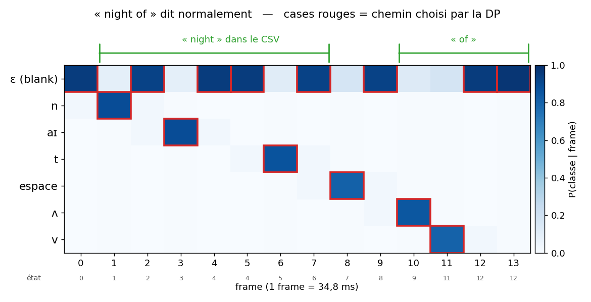
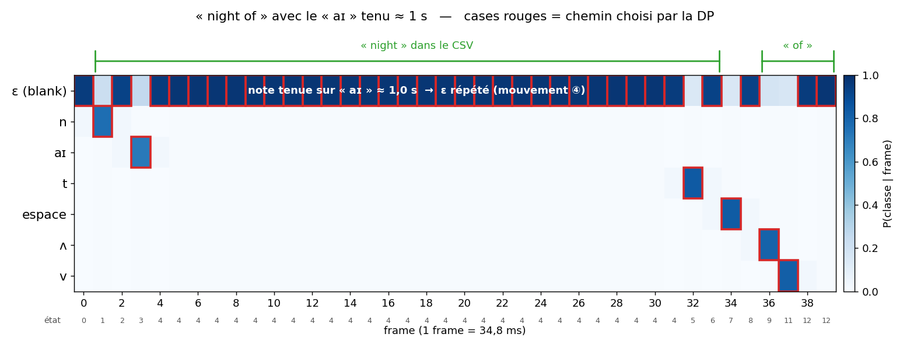
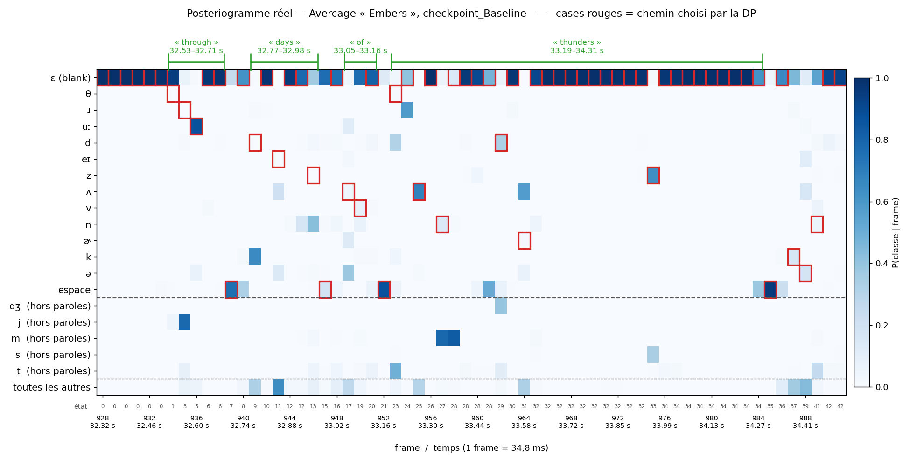

# Comprendre les états et les transitions de l'alignement (CTC / Viterbi)

Code concerné : `LyricsAlignment-Multilingual/utils.py`, fonction `alignment` (l. 126-234).

Tous les chemins de ce fichier ont la forme de ceux que **le modèle du dépôt** (`checkpoint_Baseline`) produit réellement. Ce comportement a été mesuré sur *Avercage – Embers* (voir la dernière section).

## Rappel : ce qu'on aligne

- Les paroles sont **connues**. Toute la chanson est transformée en une suite de **tokens** : les phonèmes de chaque mot, avec un token espace `␣` entre deux mots (`data.py:186`).
  Exemple : `of night` → `ʌ v ␣ n aɪ t`.
- **L = nombre de tokens de toute la chanson** (phonèmes + espaces). Pour *Embers*, L = 800.
- Le modèle donne, pour **chaque frame de 34,8 ms**, une probabilité pour chacune des 72 classes : 69 phonèmes, l'espace `␣` (n°69), « inconnu » (n°70) et le **blank ε** (n°71).
- L'alignement attribue **un seul état à chaque frame**.

## Les états

On intercale un ε avant, entre et après chaque token, ce qui donne **2L + 1 états** :

- **les états pairs (0, 2, 4, …) sont des ε** ;
- **l'état impair 2i+1 est le token n°i**.

Exemple pour `night` = `n aɪ t` (L = 3) :

| état | 0 | 1 | 2 | 3 | 4 | 5 | 6 |
|---|---|---|---|---|---|---|---|
| symbole | ε | n | ε | aɪ | ε | t | ε |

## Comment se comporte le modèle du dépôt : « en pics »

- **Chaque phonème occupe 1 frame** (dans 93 % des cas, et jamais plus de 2).
- **Tout le reste est ε** : 88 % des frames du chemin.
- Une **note tenue** donne donc **le phonème une fois, puis une suite de ε**. Le phonème n'est pas répété n fois.
- **Un ε ne veut pas dire « silence ».** Il veut dire « rien de nouveau n'est émis ici ». Le même ε couvre une voyelle tenue, une transition, un silence ou un passage instrumental.
- **L'espace `␣` ne veut pas dire « silence » non plus.** C'est un token de frontière de mot qui occupe 1 frame, en général **juste avant le mot suivant**.

## Pourquoi des états blank ?

- **Le modèle a été entraîné avec la CTC** (`train.py:164`), qui contient la classe ε. Comme on vient de le voir, il met presque toute sa probabilité sur ε entre deux pics. Si on supprimait les états ε, chaque frame où le modèle est sûr de ε devrait être attribuée à un phonème improbable, et l'alignement deviendrait arbitraire. Il faut décoder avec la même structure que celle utilisée à l'entraînement.
- **La CTC n'oblige pas à mettre des ε.** À l'entraînement, la loss additionne la probabilité de *tous* les chemins compatibles avec les paroles, avec ou sans ε. C'est le modèle qui a appris de lui-même à prédire ε presque partout.
- **Pourquoi la CTC plutôt qu'une classification frame par frame ?** La classification frame par frame demanderait de connaître le phonème de chaque frame de 35 ms dans tout le corpus DALI, et ces annotations n'existent pas. La CTC permet d'entraîner le modèle avec seulement l'audio et le texte.
- **Le postériogramme n'est jamais modifié.** C'est la matrice complète 72 × T. Ce sont les états ε qui sont facultatifs dans le chemin : quand deux phonèmes sont très rapprochés, le chemin peut passer directement de l'un à l'autre (saut ③ ci-dessous) sans visiter le ε entre eux.

## Les 5 mouvements possibles

D'une frame à la suivante, seuls ces 5 mouvements sont possibles. La dernière colonne indique combien de fois chacun est utilisé dans le chemin d'*Embers* (6963 transitions au total).
┌─────┬───────────────────────┬────────────────────────────────────────────────────────────────┬──────────────────────┐
│  #  │       mouvement       │                              sens                              │ fréquence sur Embers │
├─────┼───────────────────────┼────────────────────────────────────────────────────────────────┼──────────────────────┤
│ ④   │ ε → même ε            │ l'attente continue (tenue, silence, intro…)                    │ 5 600                │
├─────┼───────────────────────┼────────────────────────────────────────────────────────────────┼──────────────────────┤
│ ⑤   │ ε → token suivant     │ un nouveau son commence (le pic)                               │ 507                  │
├─────┼───────────────────────┼────────────────────────────────────────────────────────────────┼──────────────────────┤
│ ②   │ token → ε suivant     │ le pic est fini, on entre dans l'attente                       │ 507                  │
├─────┼───────────────────────┼────────────────────────────────────────────────────────────────┼──────────────────────┤
│ ③   │ token → token suivant │ deux sons collés, sans attente entre eux                       │ 293                  │
├─────┼───────────────────────┼────────────────────────────────────────────────────────────────┼──────────────────────┤
│ ①   │ token → même token    │ le même son déborde sur une frame de plus (pas une répétition) │ 56                   │
└─────┴───────────────────────┴────────────────────────────────────────────────────────────────┴──────────────────────┘

Règles globales :
- le chemin **commence à l'état 0** (frame 0 = ε) et **finit à l'état 2L** (dernier ε) ;
- on ne **recule jamais** ;
- on ne **saute jamais un token** : chaque phonème et chaque espace occupe **au moins une frame**.

```
état :    0      1      2      3      4      5      6
          ④      ①      ④      ①      ④      ①      ④      ← rester (+0)
          ε  ─⑤▶ n  ─②▶ ε  ─⑤▶ aɪ ─②▶ ε  ─⑤▶ t  ─②▶ ε      ← +1
                 │            ▲ │            ▲
                 └──── ③ ─────┘ └──── ③ ─────┘             ← +2 (token → token)
```

Le schéma le plus fréquent est donc : **⑤ (pic) → ② (retour en ε) → ④ ④ ④… (attente) → ⑤ (pic suivant)**.

Dans les tableaux qui suivent, la colonne « mouvement » renvoie à ces numéros.

---

## Exemple 1 : « night » dit normalement

| frame | 0 | 1 | 2 | 3 | 4 | 5 | 6 | 7 |
|---|---|---|---|---|---|---|---|---|
| état | 0 | 1 | 2 | 3 | 4 | 4 | 5 | 6 |
| symbole | ε | n | ε | aɪ | ε | ε | t | ε |
| mouvement | départ | ⑤ | ② | ⑤ | ② | ④ | ⑤ | ② |

Chaque phonème correspond à un pic d'une frame, et les frames entre deux pics sont sur le ε intermédiaire.

## Exemple 2 : « night » avec le « aɪ » tenu (≈ 1 s ≈ 29 frames)

| frame | 0 | 1 | 2 | 3 | 4 | 5 | … | 31 | 32 | 33 |
|---|---|---|---|---|---|---|---|---|---|---|
| état | 0 | 1 | 2 | 3 | 4 | 4 | 4 | 4 | 5 | 6 |
| symbole | ε | n | ε | aɪ | ε | ε | ε | ε | t | ε |
| mouvement | départ | ⑤ | ② | ⑤ | ② | ④ | ④ ×25 | ④ | ⑤ | ② |

- Le « aɪ » n'apparaît **qu'une fois** (frame 3), au moment où il commence.
- Toute la tenue est sur **l'état 4**, le ε entre aɪ et t (mouvement ④ répété).
- Ces frames restent entre le n et le t, donc à l'intérieur du mot « night ».

> **Plusieurs ε d'affilée ?** Oui, c'est même le cas le plus courant (mouvement ④). Pendant une note tenue, c'est le ε **juste après le phonème tenu** qui se répète. L'**état 0** ne se répète que pendant l'intro (exemple 4), car c'est le ε placé avant le tout premier token de la chanson.

## Exemple 3 : sons rapprochés, cas réel de « through » dans *Embers*

Tokens du début de la chanson : `θ ɹ uː ␣ d eɪ z …`, donc les états 1 = θ, 3 = ɹ, 5 = uː, 7 = ␣, 9 = d.

| frame | 931 | 932 | 933 | 934 | 935 | 936 | 937 | 938 | 939 | 940 | 941 |
|---|---|---|---|---|---|---|---|---|---|---|---|
| état | 0 | 0 | 0 | 1 | 3 | 5 | 6 | 6 | 7 | 8 | 9 |
| symbole | ε | ε | ε | θ | ɹ | uː | ε | ε | ␣ | ε | d |
| mouvement | ④ | ④ | ④ | ⑤ | **③** | **③** | ② | ④ | ⑤ | ② | ⑤ |

- θ, ɹ et uː sont émis sur **trois frames consécutives** grâce aux sauts ③. Les ε intermédiaires (états 2 et 4) ne sont pas visités.
- Dans le CSV : « through » commence à la frame 934 (934 × 34,8 ms = **32,53 s**) et finit à la première frame sur `␣`, la 939 (**32,71 s**). « days » commence à la frame 941 (**32,77 s**). Ce sont exactement les valeurs du CSV.

## Exemple 4 : intro instrumentale avant le premier mot

Dans *Embers*, le premier mot (« through ») commence à la frame 934 (32,53 s).

| frame | 0 | 1 | … | 933 | 934 | … |
|---|---|---|---|---|---|---|
| état | 0 | 0 | 0 | 0 | 1 | … |
| symbole | ε | ε | ε | ε | θ | … |
| mouvement | départ | ④ | ④ ×931 | ④ | ⑤ | … |

Toute l'intro reste sur l'état 0.

## Exemple 5 : « of night » chanté lié (avec le token espace)

Tokens : `ʌ v ␣ n aɪ t` (L = 6), soit 13 états :

| état | 0 | 1 | 2 | 3 | 4 | 5 | 6 | 7 | 8 | 9 | 10 | 11 | 12 |
|---|---|---|---|---|---|---|---|---|---|---|---|---|---|
| symbole | ε | ʌ | ε | v | ε | ␣ | ε | n | ε | aɪ | ε | t | ε |

| frame | 0 | 1 | 2 | 3 | 4 | 5 | 6 | 7 | 8 | 9 | 10 | 11 | 12 |
|---|---|---|---|---|---|---|---|---|---|---|---|---|---|
| état | 0 | 1 | 3 | 4 | 5 | 6 | 7 | 8 | 9 | 10 | 10 | 11 | 12 |
| symbole | ε | ʌ | v | ε | ␣ | ε | n | ε | aɪ | ε | ε | t | ε |
| mouvement | départ | ⑤ | ③ | ② | ⑤ | ② | ⑤ | ② | ⑤ | ② | ④ | ⑤ | ② |

- **L'espace occupe obligatoirement une frame** (frame 4), même si les mots sont liés, parce qu'on ne peut pas sauter un token.
- Dans le CSV (`utils.py:216-232`) :
  - **« of »** commence à la première frame sur ʌ (frame 1) et finit à la première frame sur `␣` (frame 4) ;
  - **« night »** commence à la première frame sur n (frame 6). C'est le dernier mot, donc il n'y a pas d'espace après lui et sa fin est la dernière frame de l'audio.

## Exemple 6 : un mot fini, puis un silence

Même phrase, mais avec un silence d'environ 0,5 s (14 frames) entre « of » et « night ». Comme le modèle place `␣` **juste avant le mot suivant**, tout le silence se retrouve sur le ε qui suit le v (état 4) :

| frame | 0 | 1 | 2 | 3 | … | 16 | 17 | 18 | 19 | 20 | 21 | 22 | 23 |
|---|---|---|---|---|---|---|---|---|---|---|---|---|---|
| état | 0 | 1 | 3 | 4 | 4 | 4 | 5 | 6 | 7 | 8 | 9 | 10 | 11 … |
| symbole | ε | ʌ | v | ε | ε | ε | ␣ | ε | n | ε | aɪ | ε | t … |
| mouvement | départ | ⑤ | ③ | ② | ④ ×12 | ④ | ⑤ | ② | ⑤ | ② | ⑤ | ② | ⑤ |

- « of » va de la frame 1 à la frame 17 (première frame sur `␣`) : **le silence est compté dans « of »**.
- « night » commence à la frame 19.

C'est exactement ce qui arrive à « forever » dans *Embers* : `f ɚ ɹ ɛ ε×7 v×2 ε×2 ɚ ε×873 ␣`. Le pont instrumental de 30 s qui suit le mot est compté dedans, et le CSV donne 138,34–**169,31 s**.

## Exemple 7 : mouvements interdits

| tentative (avec les états de l'exemple 5) | écart | pourquoi c'est interdit |
|---|---|---|
| aɪ (9) → n (7) | −2 | on ne recule jamais |
| n (7) → t (11) | +4 | sauterait le token aɪ |
| v (3) → n (7) | +4 | sauterait le token espace |
| ε (4) → ε (6) | +2 | depuis un ε, seul +1 est permis (sinon on saute `␣`) |
| ε (2) → ␣ (5) | +3 | sauterait v |
| deux tokens dans une même frame | — | une frame = un seul état |
| commencer sur ʌ à la frame 0 | — | le chemin commence obligatoirement à l'état 0 (ε) |

## Cas particulier : deux tokens identiques consécutifs

En CTC standard, deux tokens identiques à la suite (`l l`) doivent être séparés par un ε, et le saut ③ entre eux est interdit. Sinon, « rester sur l » (①) et « passer au l suivant » (③) donneraient la même chose. Le code de `utils.alignment` ne fait pas cette vérification et autorise ③ dans ce cas. Comme les mots sont séparés par `␣`, ce cas n'apparaît qu'à l'intérieur d'un mot.

## Bug connu : retour en arrière via l'indice −1

Pour le premier token (`ch_pos = 1`), le mouvement ③ lit `s[t-1][ch_pos-2]`, c'est-à-dire `s[t-1][-1]`. En Python, l'indice `-1` renvoie au **dernier état** de la chaîne. Le chemin peut donc « finir » toute la chanson puis recommencer au premier phonème.

Ce comportement a été reproduit avec un test synthétique : un `ʌ v` parasite dans l'intro, puis le vrai `ʌ v` plus tard. Il peut se produire sur une longue intro où le modèle active des phonèmes à tort. Le même code existe dans `alignment_bdr`. Correctif : ne calculer `b` que si `ch_pos >= 3`.

---

## Mesures sur *Embers* (`checkpoint_Baseline`)

On a fait tourner le modèle sur `jamendo_example` et récupéré le chemin frame par frame. Les temps des mots sont identiques à ceux de `pred/Avercage_-_Embers_align.csv`.

Notation : `ε×7` = 7 frames de suite sur le même ε.

| mesure | valeur |
|---|---|
| frames de la chanson | 6964 (≈ 242 s) |
| frames où l'argmax du modèle est ε | **91 %** |
| frames du chemin sur un état ε | **88 %** |
| durée d'un passage sur un phonème | **1 frame dans 93 % des cas**, 2 au maximum |
| états ε visités | 508 sur 801 (les autres sont sautés par ③) |
| P(␣) sur les frames attribuées à l'espace | médiane 0,68 (contre 0,00005 ailleurs) |

Quelques mots, avec 3 frames de contexte de chaque côté :

| mot | temps (CSV) | chemin |
|---|---|---|
| through | 32,53–32,71 s | `ε×3` **`θ ɹ uː ε×2`** `␣ ε d` |
| days | 32,77–32,98 s | `ε ␣ ε` **`d ε eɪ ε×2 z`** `␣ ε ʌ` |
| gone | 137,96–138,27 s | `l ε ␣` **`ɡ ε ɔ ε×4 n ε`** `␣ ε f` |
| forever | 138,34–**169,31 s** | `ε ␣ ε` **`f ɚ ɹ ɛ ε×7 v×2 ε×2 ɚ ε×873`** `␣ ε×2` |

**Où tombent les silences ?** On a relevé les 24 longues suites de ε (plus de 40 frames, soit plus de 1,4 s). **19 sont sur le ε qui suit le dernier phonème d'un mot**, donc avant l'espace et comptées dans ce mot. Parmi les 5 autres : 2 sont au milieu d'un mot, 1 seule tombe après un espace, 1 est l'intro et 1 est la fin de la chanson. Au total, 29 mots sur 189 durent plus de 1,5 s.

**Conséquence pour l'évaluation :** les **débuts** de mots sont fiables, mais les **fins** sont gonflées par les silences et les passages instrumentaux qui suivent le mot. C'est pour cette raison que les métriques d'alignement de paroles portent en général sur les débuts (onsets).

---

## Dessins : à quoi ressemble le posteriogramme

Ces deux premières figures sont **schématiques et idéalisées**. Le chemin est écrit à la main et les probabilités sont fabriquées. Elles reprennent la forme du chemin mesurée sur *Embers* (un token sur 1 frame, ε partout ailleurs), mais avec un modèle « parfait » qui reconnaîtrait toujours le bon phonème. Ce n'est pas le cas en vrai : voir la troisième figure, qui est réelle. La phrase utilisée est « night of » (tokens `n aɪ t ␣ ʌ v`).

Comment les lire :
- **chaque colonne est une frame** de 34,8 ms ;
- **chaque ligne est une classe** du softmax (seules celles de la phrase sont affichées, les 72 existent) ;
- **la couleur est la probabilité** donnée par le modèle : plus c'est foncé, plus le modèle est sûr ;
- **les cases rouges forment le chemin choisi par la DP**, avec une seule case par colonne ;
- la ligne « état » sous l'axe donne le numéro d'état (pair = ε, impair = token) ;
- les accolades vertes montrent l'intervalle écrit dans le CSV : du premier phonème du mot jusqu'à la première frame de l'espace qui suit.

### Sans note tenue



On retrouve les mouvements ⑤ (pic) puis ② (retour en ε). Entre « ʌ » et « v », les frames 10 et 11 sont deux pics consécutifs, reliés par un saut ③ (état 9 → 11, l'état 10 n'est pas visité).

### Avec le « aɪ » tenu ≈ 1 s



Le « aɪ » ne s'allume **qu'une frame** (la frame 3). Pendant toute la tenue, c'est la ligne ε qui est foncée, et le chemin reste sur l'**état 4** (mouvement ④ répété). La tenue est bien comptée dans « night », puisque l'accolade va jusqu'à l'espace. Si la tenue était remplacée par un silence ou par un passage instrumental, **la figure serait identique** : le modèle ne fait pas la différence.

### Posteriogramme réel : « through days of thunders » (*Embers*, 32,3–34,5 s)

Cette figure est produite par **le vrai modèle** (`checkpoint_Baseline`) et **la vraie DP** du dépôt. Les accolades vertes redonnent exactement les temps du CSV.



Organisation des lignes :
- en haut, ε, puis les phonèmes des paroles (dans l'ordre d'apparition), puis l'espace ;
- sous le trait pointillé, les classes **hors paroles** que le modèle active fortement (P > 0,3) dans ce passage ;
- tout en bas, la somme de toutes les autres classes.

**Ce qu'on voit, et qui n'apparaît pas dans les schémas :**

1. **Les pics sont bien placés dans le temps, mais souvent sur le mauvais phonème.** Le modèle détecte bien qu'un son nouveau commence, mais il ne reconnaît pas toujours lequel :

   | frame | phonème imposé par les paroles | P(phonème imposé) | ce que le modèle « voit » |
   |---|---|---|---|
   | 935 | ɹ (through) | 0,00 | j (0,78) |
   | 941 | d (days) | 0,00 | k (0,65), ɡ (0,28) |
   | 957 | n (thunders) | 0,14 | m (0,79) |
   | 964 | ɚ (thunders) | 0,02 | ʌ (0,58) |

   Les confusions se font entre sons proches : d/k/ɡ, n/m, ɚ/ʌ.

2. **La DP impose quand même le phonème des paroles**, même si sa probabilité est quasi nulle (cases rouges sur fond blanc). Elle n'a pas le choix : chaque token doit occuper au moins une frame, et le chemin le place là où il coûte le moins. C'est en général sur un pic d'une autre classe, ou sur une frame où ε est moins sûr. Sur toute la chanson, le phonème imposé n'est l'argmax du modèle que dans **30 %** des frames de phonème, et sa probabilité est **inférieure à 0,1 dans la moitié des cas**.

3. **Les espaces sont fiables.** P(␣) = 0,76, 0,87 et 0,95 sur les frames 939, 952 et 985. Sur toute la chanson, seulement 7 % des frames d'espace ont P(␣) < 0,1. Le token espace, qui fixe la **fin** de chaque mot dans le CSV et l'endroit où commence le suivant, est donc l'élément le mieux reconnu.

4. **La fin de « thunders » est presque entièrement en ε.** Entre le ɚ (frame 964) et l'espace (frame 985), il y a 19 frames de ε (environ 0,7 s), interrompues une seule fois par le z (frame 975). Ces frames sont comptées dans le mot, et la figure ne permet pas de dire s'il s'agit d'une tenue ou d'un silence.

**Pourquoi l'alignement fonctionne malgré tout :** la DP a seulement besoin de savoir **quand** il se passe quelque chose (un pic, un espace) et dans **quel ordre**. Elle n'a pas besoin que l'identité du phonème soit juste, puisque la suite de phonèmes est déjà connue par les paroles. Le modèle donne le rythme, et les paroles donnent le contenu.
